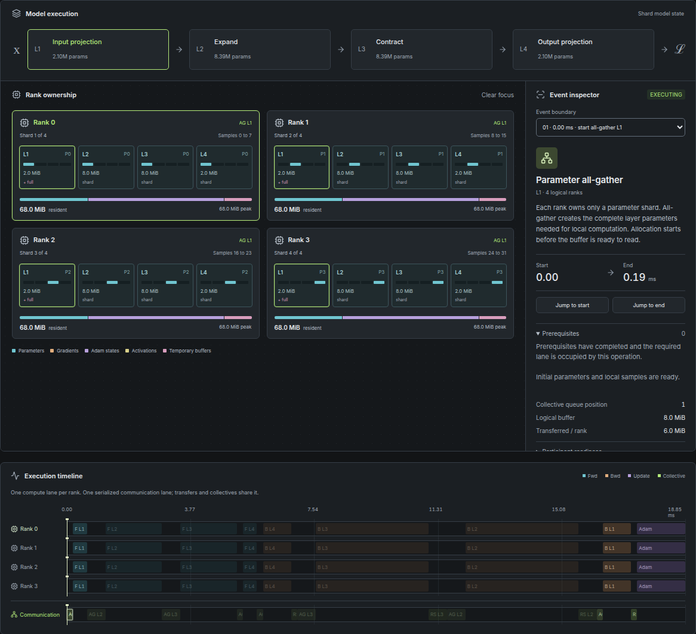

# Parallel Training Lab

See what each GPU rank owns, computes, and waits for during one training step.

Parallel Training Lab makes distributed training inspectable: follow parameters through forward and backward passes, watch communication unlock the next operation, and see why memory rises and falls. Explore **DDP, FSDP, TP, PP, and EP**, or compare **ZeRO stages 1, 2, and 3**, entirely in your browser. No GPU, CUDA, model downloads, or backend required.

**[Open Parallel Training Lab](https://parallel-training-lab.pages.dev/)** · [Run locally](#run-locally) · [Model reference](docs/model.md) · [NCCL Lab](https://nccl-lab.pages.dev/)

[](assets/readme/fsdp-all-gather.png)

_Four-rank FSDP, paused as the first all-gather starts. Gathered buffers occupy memory before their parameters are ready to compute with. Click the screenshot for the full-size view._

## Follow your first training step

1. [Open the app](https://parallel-training-lab.pages.dev/), select **FSDP**, and keep four ranks with a global batch of 32.
2. Select the first **AG** event and choose **Jump to start**. Each rank still owns a parameter shard, but now reserves a complete layer buffer.
3. Step forward. The layer waits for all-gather to finish; backward later produces gradients that reduce-scatter returns to their owners. Adam updates the owned parameters.
4. Open **DDP vs. FSDP** from **All 7 comparisons**. Both runs use the same training problem. Compare their ownership, communication, and memory peaks, then inspect the numerical result.

Use `Space` to play or pause, `←` / `→` to step, and `R` to reset. Scrub the timeline to inspect any simulated time. Comparison runs share a clock while their event inspectors remain independent.

## Supported strategies

| Strategy                               | What a rank owns                          | Communication                                              |
| -------------------------------------- | ----------------------------------------- | ---------------------------------------------------------- |
| **DDP** — Distributed data parallel    | A complete model and optimizer replica    | Average local gradients with AllReduce                     |
| **FSDP** — Fully sharded data parallel | Parameter, gradient, and optimizer shards | AllGather parameters; ReduceScatter gradients              |
| **TP** — Tensor parallel               | Alternating column and row matrix slices  | Sum partial activations and input gradients with AllReduce |
| **PP** — Pipeline parallel             | Consecutive whole-layer stages            | Send activations forward and gradients backward            |
| **EP** — Expert parallel               | Complete experts in a top-1 MoE           | AllToAll dispatch and combine in both directions           |

DDP, FSDP, TP, and PP share the same four-layer dense problem. EP uses a separate eight-expert model and compares against its one-rank execution. FSDP shards model state; each rank still computes complete layers on local samples. TP partitions the layer computation itself.

## Compare ZeRO stages

Select **ZeRO** under **Explore** to open the **ZeRO Stage Explorer**, then select any two of DDP, ZeRO-1, ZeRO-2, and ZeRO-3. Both runs share the workload, seed, batch, ranks, and storage profile. The four-stage summary separates parameters, gradients, FP32 master weights, and Adam moments. The existing ownership, memory ledger, and timeline show the allocations as the step runs.

Choose **FP32** for `4 + 4 + 0 + 8` bytes per parameter, or **BF16 + FP32 master** for `2 + 2 + 4 + 8`. Both start at 16 bytes per parameter before sharding. The summary includes gradients and excludes activations and temporary buffers, so it differs from initial and peak allocated memory.

ZeRO-1 partitions optimizer state. ZeRO-2 also partitions synchronized gradients. Both synchronize updated parameter replicas after Adam. ZeRO-3 gathers layer parameters on demand, then releases them according to retention and prefetch settings. DDP describes replication and gradient synchronization, ZeRO describes state partitioning, and FSDP is PyTorch's fully sharded data-parallel implementation.

The BF16 profile changes storage and collective payload widths. It assumes BF16 activations and keeps JavaScript arithmetic without BF16 rounding or a hardware speedup claim. See the [ZeRO model reference](docs/model.md#zero-stage-explorer) for the formulas and schedule.

## What you can explore

- **Ownership and memory.** Select ranks and tensors to inspect replicas, shards, temporary buffers, activations, gradients, and Adam states. Current and peak allocations are tracked per rank; exceeding capacity produces an OOM marker.
- **Dependencies and overlap.** Follow compute and communication lanes to see when inputs become ready, why ranks wait, and when work can overlap.
- **Seven comparisons.** Try DDP versus FSDP, reshard versus retain, backward prefetch, one slow rank, FSDP versus TP, GPipe microbatches, and MoE distribution.
- **Numerical results.** Compare gradients and updated parameters with a single-process reference. Small seeded matrices perform the arithmetic; virtual tensor sizes drive memory and timing.
- **Reproducible experiments.** Share a versioned configuration and seed, or export events, memory history, assumptions, and results as JSON. Import regenerates the simulation locally from validated inputs.

## Run locally

Use Node.js 24 and npm:

```sh
git clone https://github.com/ziwon/parallel-training-lab.git
cd parallel-training-lab
npm ci
npm run dev
```

Vite prints the local URL. The app uses React and TypeScript; the development server binds to `0.0.0.0` for access from another device.

Check the engine and create a production build:

```sh
npm run check
npx playwright install chromium
npm run test:e2e
```

`npm run check` runs type checking, unit tests, and the build. Tests cover reference arithmetic, tensor ownership, dependencies, buffer lifetimes, replay, and serialization. End-to-end checks exercise strategy switching, comparisons, inspection, export, and mobile layouts.

`npm run build` writes the static application to `dist/`. Use `npm run preview` to serve that build locally.

### Deploy to Cloudflare Pages

The [live application](https://parallel-training-lab.pages.dev/) deploys automatically when commits are pushed to `main` and [GitHub Actions](.github/workflows/check.yml) passes. Pull requests run the same checks without triggering production deployment. The workflow can also be run manually from the Actions tab.

The workflow uses Node.js 24 for type checking, unit tests, a production build, and Chromium end-to-end tests. Its dependent deploy job calls a Cloudflare Pages deploy hook for `main`. Cloudflare then fetches the branch, runs `npm run check`, and publishes only if its build succeeds. A successful deploy job confirms that Cloudflare accepted the build request; the Pages dashboard shows the final deployment status.

The hook URL is stored in the repository's `CLOUDFLARE_DEPLOY_HOOK` Actions secret, never in source. Native Pages production push deployments are disabled so production builds start through the tested workflow. This avoids relying on the Git integration's push event delivery, which did not trigger a build during setup.

To deploy your own copy, connect a separate Pages project to your repository with these settings:

| Setting              | Value             |
| -------------------- | ----------------- |
| Build command        | `npm run check`   |
| Output directory     | `dist`            |
| Production branch    | `main`            |
| Environment variable | `NODE_VERSION=24` |

For this workflow, create a Pages deploy hook for `main`, save its URL as the `CLOUDFLARE_DEPLOY_HOOK` repository secret, and disable native automatic production branch deployments in Pages to avoid duplicate builds. The checked-in `wrangler.jsonc` records the Pages project name and output directory; change the name for your own project. Any static host can serve the build; there are no server routes or runtime secrets. See Cloudflare’s [React deployment guide](https://developers.cloudflare.com/pages/framework-guides/deploy-a-react-site/).

For a manual production deployment, authenticate Wrangler with the project’s Cloudflare account, then run:

```sh
npm run build
npx wrangler@4 pages deploy dist --project-name parallel-training-lab --branch main
```

Use your own project name when deploying a fork. If a push does not deploy, check the Actions test and deploy jobs, the deploy-hook secret, and the Pages build log. Cloudflare must retain GitHub App access to the repository to fetch the source.

## Understand the model’s limits

This is an educational simulator. It does not run PyTorch or NCCL kernels, benchmark hardware, or predict production scaling.

- Each experiment models **one Adam step** with two moment states. JavaScript numbers provide representative arithmetic without emulating FP32 or BF16 rounding. The default storage profile is FP32.
- Timings come from explicit dependencies, compute budgets, and latency-plus-bandwidth costs. Each rank has one compute lane; the group shares one serialized communication lane. Ranks do not represent physical GPU wiring.
- DDP, ZeRO, and FSDP split equal local batches; TP ranks cooperate on the same samples; PP accumulates microbatches. Comparisons preserve the global batch without rounding or dropping samples.
- FSDP is layer-wise and FSDP2-inspired. Retention and prefetch have explicit buffer lifetimes, but this is not a runtime-exact allocation model.
- PP uses **GPipe** with 1, 2, or 4 stages. Other strategies support 1, 2, 4, or 8 ranks. EP uses eight linear experts and a **fixed top-1 router**, with no dropped tokens or router training.
- Strategies run independently. Hybrid parallel meshes, precision rounding, checkpointing, CPU offload, and real profiler import are outside this release.

Read the [model reference](docs/model.md) for the formulas, memory lifetimes, hand-checkable fixtures, and links to the official mechanisms.

## Continue in NCCL Lab

Parallel Training Lab explains **why communication is needed and when training can proceed**. [NCCL Lab](https://nccl-lab.pages.dev/) shows **how a collective moves data among ranks**.

Choose **Explore this collective in NCCL Lab** in the event inspector to carry over its operation, rank count, and logical size. TP links preserve SUM reductions. EP links identify the difference between routed payloads and NCCL Lab’s uniform AllToAll example; pipeline send/receive has no equivalent link. This simulator works independently of the external site.

## Documentation

- [Model reference](docs/model.md) — numerical semantics, memory accounting, communication costs, limitations, and primary references.
- [Scenario guide](docs/scenarios.md) — what to inspect and learn in each comparison.
- [Architecture](docs/architecture.md) — the boundary between deterministic simulation and React playback.
